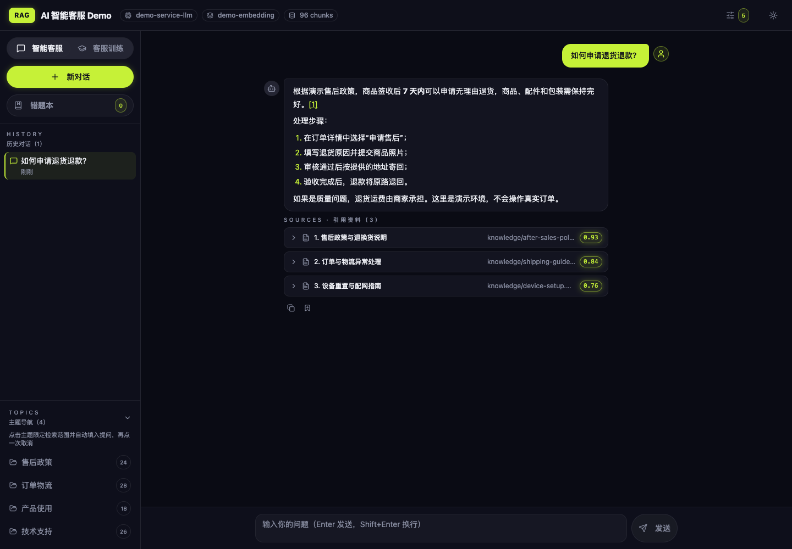
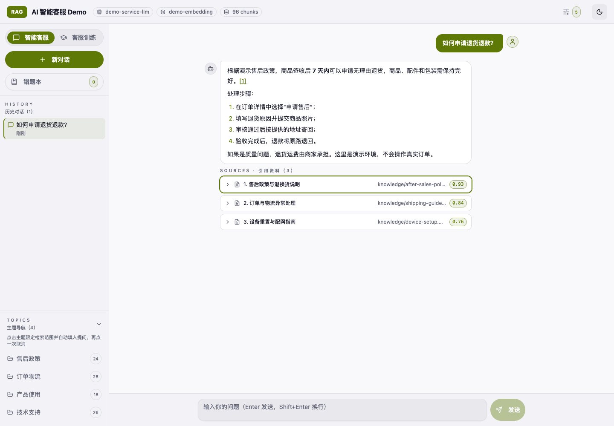
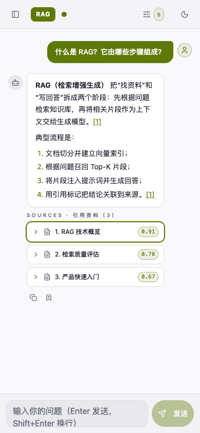
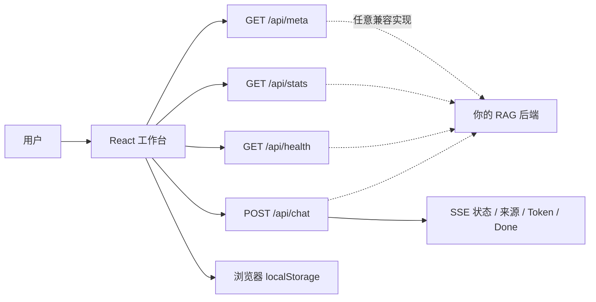

# AI 智能客服工作台（RAG Chat UI）

一个后端无关、可独立运行的 **AI 智能客服前端**。基于 **React 19 + TypeScript + Vite + Tailwind CSS + shadcn/ui**，支持售后咨询、订单物流、产品指导、来源引用、客服训练与本地会话管理。

项目只约定一组简单的 HTTP / SSE 接口，不绑定特定模型、向量数据库或企业知识库。内置零依赖客服演示 API，克隆后无需准备模型或后端即可体验完整流程，也可以接入自己的 RAG 服务。

## 界面预览

<table>
  <tr>
    <td></td>
    <td></td>
  </tr>
  <tr>
    <td align="center">桌面端 · 暗色主题</td>
    <td align="center">桌面端 · 浅色主题</td>
  </tr>
</table>



## 功能特性

| 能力 | 说明 |
| --- | --- |
| 智能咨询 | 通过 SSE 展示检索、生成、降级阶段，逐字回答售后、物流与产品问题，可随时停止 |
| 来源可核验 | 回答中的 `[n]` 可定位到政策或产品资料，展示相关度并提示低相关结果 |
| 可信拒答 | 后端通过 SSE `handoff` 事件终止无依据回答，覆盖低置信度与客户主动转人工场景 |
| 人工交接 | 提供最近对话、知识主题和交接原因摘要，可复制给真实客服；演示模式不会谎称已通知坐席 |
| 满意度反馈 | 每条正常回答支持“有用／没用”，选择结果随会话保存并在刷新后恢复 |
| 客服训练 | 支持综合或专题考核、连续出题、标准口径解析与“再考我一次” |
| 错题复习 | 自动收录与手动收藏，支持主题筛选、复习计数和掌握状态管理 |
| 会话管理 | 新建、切换、删除历史咨询；最多保存 50 个会话，刷新后自动恢复 |
| 知识库隔离 | 以 `kbId` 隔离不同企业或业务线的会话和错题，避免本地数据互相污染 |
| 业务主题与检索 | 按售后政策、订单物流等主题过滤，Top-K 1–10 调整，支持明暗主题 |
| 健壮交互 | 请求所有权隔离、失败重试、手动停止、中文输入法与移动端适配 |
| 元数据驱动 | 品牌、标语、业务模式、示例问题和训练引导均由后端 `/api/meta` 提供 |

## 30 秒本地体验

环境要求：Node.js 22.12+ 与 npm。

```bash
git clone https://github.com/jamy-qi/ai-customer-service-ui.git
cd ai-customer-service-ui
npm ci
npm run dev:mock
```

打开 <http://localhost:3000>。Mock API 运行在 `127.0.0.1:8787`，按 `Ctrl+C` 会同时停止前端与演示服务。

可以尝试：

1. 点击“如何申请退货退款？”，观察流式回答与政策来源；
2. 选择“订单物流”主题，咨询物流超过 48 小时未更新的处理方式；
3. 切换“客服训练”，开始综合或专题考核并查看标准口径；
4. 打开错题本复习，或新建咨询、调整 Top-K 后刷新页面验证状态恢复。

## 接入自己的 RAG 后端

后端只需实现 4 个端点：`GET /api/meta`、`GET /api/stats`、`GET /api/health`、`POST /api/chat`。完整字段与 SSE 协议见 [接口与架构说明](docs/design.md)。

复制环境变量示例并修改后端地址：

```bash
cp .env.example .env.local
# .env.local 中：VITE_API_TARGET=http://localhost:8000
npm run dev
```

开发服务器会把 `/api/*` 代理到 `VITE_API_TARGET`，因此前端不需要处理跨域。生产构建使用同源 `/api/*`，请在网关或 Web 服务器上将这组路径反向代理到后端。

> 本项目是前端仓库，不包含文档切分、Embedding、向量检索或模型推理实现。

## 演示边界

内置售后政策、商品和订单内容均为虚构演示数据，不能作为真实业务承诺。当前版本**不连接真实订单、支付、人工坐席或工单系统**，也不会执行退款、改单等操作；这些动作需要由你的后端鉴权并对接相应业务系统。

## 常用命令

| 命令 | 用途 |
| --- | --- |
| `npm run dev` | 连接真实后端，启动开发服务器 |
| `npm run dev:mock` | 同时启动前端与内置 Mock API |
| `npm run mock` | 仅启动 Mock API |
| `npm test` | 运行 Vitest 单元与组件测试 |
| `npm run test:e2e` | 运行 Playwright 浏览器端到端测试 |
| `npm run test:e2e:ui` | 打开 Playwright 交互式测试界面 |
| `npm run test:e2e:report` | 查看最近一次 E2E HTML 报告 |
| `npm run lint` | 运行 ESLint |
| `npm run build` | TypeScript 检查并生成 `dist/` |
| `npm run preview` | 本地预览生产构建 |

### 演示异常与降级状态

```bash
# 模拟本地模型不可用，验证知识库摘录降级
MOCK_LLM=off npm run dev:mock

# 模拟可重试的流式错误
MOCK_ERROR=1 npm run dev:mock

# 调整逐字输出间隔（毫秒）
MOCK_DELAY=80 npm run dev:mock
```

## 浏览器端到端测试

首次运行前安装 Chromium，然后执行测试：

```bash
npx playwright install chromium
npm run test:e2e
```

Playwright 会自动启动并在结束后停止前端与 Mock API，无需先手动运行开发服务器。测试覆盖售后回答与来源引用、反馈刷新恢复、低置信度拒答、交接摘要复制、主动转人工、客服训练和 375px 移动端布局。失败时保留截图、Trace 和 HTML 报告。

本机已有 Chrome 时，也可以通过 `PLAYWRIGHT_CHROMIUM_EXECUTABLE_PATH` 指定浏览器程序路径，无需重复下载 Chromium。

## 持续集成

`.github/workflows/ci.yml` 会在 `main` 分支推送及 Pull Request 时自动执行 ESLint、Vitest、生产构建和 Playwright E2E。E2E 失败时，GitHub Actions 会保留 7 天测试报告与 Trace，便于定位问题。

## 架构概览



前端只负责交互与状态管理；检索、上下文拼装、模型调用及引用内容均由后端决定。会话和错题仅存储在当前浏览器，不会跨设备同步，清除浏览器数据会将其删除。

## 项目结构

```text
.
├── .github/workflows/ci.yml # GitHub Actions 持续集成
├── e2e/                   # Playwright 真实浏览器流程
├── mock/                  # 零依赖演示 API 与联合启动脚本
├── src/
│   ├── components/        # 顶栏、侧栏、消息、来源、错题本等
│   ├── components/ui/     # shadcn/ui 基础组件
│   ├── hooks/             # 响应式 Hook
│   ├── lib/               # API、SSE、会话、错题、主题与引用逻辑
│   ├── pages/             # Home 页面与请求生命周期
│   └── types/             # 前后端共享契约的 TypeScript 类型
├── docs/
│   ├── design.md          # API、SSE、状态与存储设计
│   ├── components.md      # 组件职责与数据流
│   └── screenshots/       # README 界面截图
├── .env.example           # 后端与 Mock 配置示例
├── playwright.config.ts   # E2E 浏览器与演示服务配置
└── vite.config.ts         # Vite 与开发代理配置
```

## 文档导航

- [接口与架构说明](docs/design.md)：API 契约、SSE 状态机、请求竞态与本地数据模型。
- [组件说明](docs/components.md)：组件树、职责边界及关键模块。
- [原始设计记录](docs/superpowers/specs/2026-09-12-rag-chat-ui-design.md)：项目目标与演进背景。

## 技术说明

- UI：React、TypeScript、Tailwind CSS、shadcn/ui、Lucide。
- Markdown：`react-markdown`，引用标记在渲染前转换为页内锚点。
- 测试：Vitest、Testing Library、JSDOM、Playwright。
- Mock：Node.js 原生 `node:http`，无额外运行时依赖。

## License

当前仓库尚未指定开源许可证。复制、修改或再分发前，请先联系仓库所有者确认授权。
