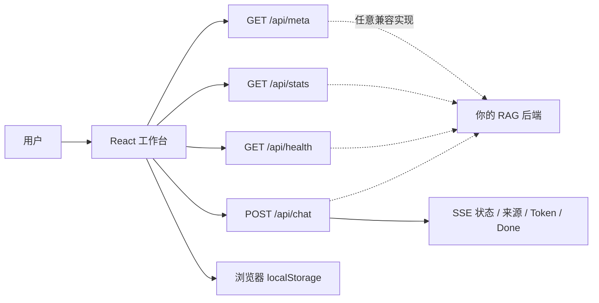

# RAG Chat UI

一个后端无关、可独立运行的 RAG 聊天工作台。基于 **React 19 + TypeScript + Vite + Tailwind CSS + shadcn/ui**，支持流式回答、来源引用、模拟面试、错题复习与本地会话管理。

项目只约定一组简单的 HTTP / SSE 接口，不绑定特定模型、向量数据库或知识库。内置零依赖 Mock API，克隆后无需准备模型或后端即可体验完整流程。

## 界面预览

<table>
  <tr>
    <td></td>
    <td></td>
  </tr>
  <tr>
    <td align="center">桌面端 · 暗色主题</td>
    <td align="center">桌面端 · 浅色主题</td>
  </tr>
</table>


## 功能特性

| 能力 | 说明 |
| --- | --- |
| 流式问答 | 通过 SSE 展示检索、生成、降级阶段，逐字渲染回答，可随时停止 |
| 来源引用 | 回答中的 `[n]` 可定位到来源卡片，展示相关度并提示低相关结果 |
| 模拟面试 | 支持综合或主题面试、连续出题、答案解析与“再考我一次” |
| 错题本 | 自动收录与手动收藏，支持主题筛选、复习计数和掌握状态管理 |
| 会话管理 | 新建、切换、删除历史会话；最多保存 50 个会话，刷新后自动恢复 |
| 知识库隔离 | 以 `kbId` 隔离不同知识库的会话和错题，避免本地数据互相污染 |
| 主题与检索设置 | 主题过滤、Top-K 1–10 调整、明暗主题切换并记忆偏好 |
| 健壮交互 | 请求所有权隔离、失败重试、手动停止、中文输入法与移动端适配 |
| 元数据驱动 | 应用名、标语、模式、示例问题和面试引导均由后端 `/api/meta` 提供 |

## 30 秒本地体验

环境要求：Node.js 22.12+ 与 npm。

```bash
git clone https://github.com/jamy-qi/rag-chat-ui.git
cd rag-chat-ui
npm ci
npm run dev:mock
```

打开 <http://localhost:3000>。Mock API 运行在 `127.0.0.1:8787`，按 `Ctrl+C` 会同时停止前端与演示服务。

可以尝试：

1. 点击示例问题，观察流式回答与来源引用；
2. 切换“模拟面试”，开始综合或专题面试；
3. 回答“我不会”，查看解析并打开错题本复习；
4. 新建对话、切换主题或调整 Top-K，刷新页面验证状态恢复。

## 接入自己的 RAG 后端

后端只需实现 4 个端点：`GET /api/meta`、`GET /api/stats`、`GET /api/health`、`POST /api/chat`。完整字段与 SSE 协议见 [接口与架构说明](docs/design.md)。

复制环境变量示例并修改后端地址：

```bash
cp .env.example .env.local
# .env.local 中：VITE_API_TARGET=http://localhost:8000
npm run dev
```

开发服务器会把 `/api/*` 代理到 `VITE_API_TARGET`，因此前端不需要处理跨域。生产构建使用同源 `/api/*`，请在网关或 Web 服务器上将这组路径反向代理到后端。

> 本项目是前端仓库，不包含文档切分、Embedding、向量检索或模型推理实现。

## 常用命令

| 命令 | 用途 |
| --- | --- |
| `npm run dev` | 连接真实后端，启动开发服务器 |
| `npm run dev:mock` | 同时启动前端与内置 Mock API |
| `npm run mock` | 仅启动 Mock API |
| `npm test` | 运行 Vitest 单元与组件测试 |
| `npm run lint` | 运行 ESLint |
| `npm run build` | TypeScript 检查并生成 `dist/` |
| `npm run preview` | 本地预览生产构建 |

### 演示异常与降级状态

```bash
# 模拟本地模型不可用，验证知识库摘录降级
MOCK_LLM=off npm run dev:mock

# 模拟可重试的流式错误
MOCK_ERROR=1 npm run dev:mock

# 调整逐字输出间隔（毫秒）
MOCK_DELAY=80 npm run dev:mock
```

## 架构概览



前端只负责交互与状态管理；检索、上下文拼装、模型调用及引用内容均由后端决定。会话和错题仅存储在当前浏览器，不会跨设备同步，清除浏览器数据会将其删除。

## 项目结构

```text
.
├── mock/                    # 零依赖演示 API 与联合启动脚本
├── src/
│   ├── components/          # 顶栏、侧栏、消息、来源、错题本等
│   ├── components/ui/       # shadcn/ui 基础组件
│   ├── hooks/               # 响应式 Hook
│   ├── lib/                 # API、SSE、会话、错题、主题与引用逻辑
│   ├── pages/               # Home 页面与请求生命周期
│   └── types/               # 前后端共享契约的 TypeScript 类型
├── docs/
│   ├── design.md            # API、SSE、状态与存储设计
│   ├── components.md        # 组件职责与数据流
│   └── screenshots/         # README 界面截图
├── .env.example             # 后端与 Mock 配置示例
└── vite.config.ts           # Vite 与开发代理配置
```

## 文档导航

- [接口与架构说明](docs/design.md)：API 契约、SSE 状态机、请求竞态与本地数据模型。
- [组件说明](docs/components.md)：组件树、职责边界及关键模块。
- [原始设计记录](docs/superpowers/specs/2026-09-12-rag-chat-ui-design.md)：项目目标与演进背景。

## 技术说明

- UI：React、TypeScript、Tailwind CSS、shadcn/ui、Lucide。
- Markdown：`react-markdown`，引用标记在渲染前转换为页内锚点。
- 测试：Vitest、Testing Library、JSDOM。
- Mock：Node.js 原生 `node:http`，无额外运行时依赖。

## License

当前仓库尚未指定开源许可证。复制、修改或再分发前，请先联系仓库所有者确认授权。
