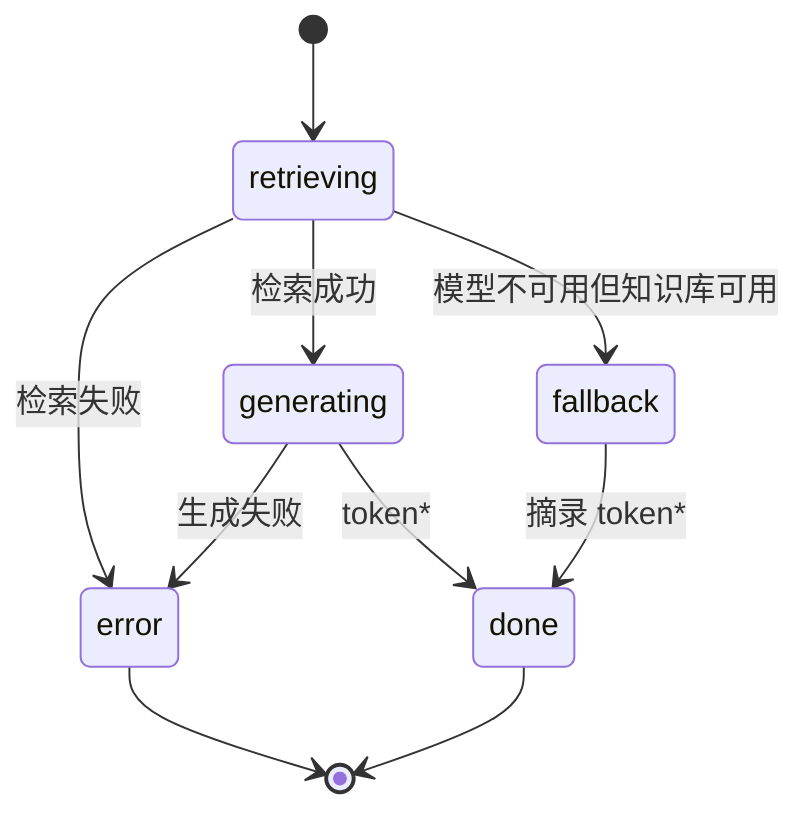

# 接口与架构说明

本文定义 `rag-chat-ui` 对后端的最低契约，以及前端的关键状态设计。实现这些接口即可复用完整界面，不要求使用特定模型或向量数据库。

## 1. 通用约定

- 开发环境通过 Vite 将同源 `/api/*` 代理到 `VITE_API_TARGET`，默认 `http://localhost:8000`。
- JSON 响应使用 `Content-Type: application/json`。
- 非 2xx 响应会被界面视为请求失败；流式过程中应优先使用结构化 SSE `error` 事件。
- `/api/meta` 失败时，前端退化为仅问答模式，并使用 `default` 作为本地存储命名空间；其他元数据接口失败不阻塞聊天。

## 2. GET /api/meta

提供品牌化与能力信息。`kbId` 必须在同一知识库内保持稳定，修改它会切换本地会话与错题命名空间。

```json
{
  "kbId": "customer-service-demo",
  "appName": "AI 智能客服 Demo",
  "tagline": "基于企业知识库，为客户提供可追溯的即时解答",
  "modes": ["qa", "interview"],
  "examples": ["如何申请退货退款？"],
  "interviewGuides": [
    {
      "title": "售后政策考核",
      "desc": "检验退换货政策与沟通口径",
      "topic": "售后政策"
    }
  ]
}
```

| 字段 | 类型 | 说明 |
| --- | --- | --- |
| `kbId` | `string` | 知识库唯一标识，用于 localStorage 隔离 |
| `appName` | `string` | 顶栏、空态和页面标题 |
| `tagline` | `string` | 空态副标题，可为空字符串 |
| `modes` | `Array<'qa' \| 'interview'>` | 不含 `interview` 时隐藏面试和错题入口 |
| `examples` | `string[]` | 问答空态示例，点击直接发送 |
| `interviewGuides` | `InterviewGuide[]` | 专题面试卡片，点击按指定主题开始 |

## 3. GET /api/stats

```json
{
  "chunks": 96,
  "llm_model": "demo-service-llm",
  "embed_model": "demo-embedding",
  "topics": [
    { "name": "售后政策", "count": 24 },
    { "name": "订单物流", "count": 28 }
  ]
}
```

`topics` 同时用于主题过滤导航。请求失败时顶栏显示“后端未连接”，但不影响输入和重试。

## 4. GET /api/health

```json
{
  "status": "ready",
  "index": { "ok": true, "chunks": 96, "error": null },
  "llm": {
    "ok": true,
    "model": "demo-service-llm",
    "base": "http://localhost:11434",
    "error": null
  }
}
```

`status` 可取 `ready`、`degraded`、`unavailable`，分别对应正常、降级、不可用。健康检查失败时界面显示未知状态。

## 5. POST /api/chat

### 请求体

```json
{
  "question": "什么是 RAG？",
  "k": 5,
  "mode": "qa",
  "topic": "技术文档",
  "history": [
    { "role": "user", "content": "之前的问题" },
    { "role": "assistant", "content": "之前的回答" }
  ]
}
```

| 字段 | 类型 | 说明 |
| --- | --- | --- |
| `question` | `string` | 当前问题；面试首次开始可发送“开始” |
| `k` | `number` | 检索条数，界面范围 1–10 |
| `mode` | `'qa' \| 'interview'` | 当前模式 |
| `topic` | `string \| null` | 主题过滤条件，`null` 表示不限定 |
| `history` | `Array<Message>` | 最近最多 20 条非错误消息，不包含当前问题 |

响应必须是 `text/event-stream`。每个事件使用一个 `data:` 字段承载 JSON，并以空行结束：

```text
data: {"type":"status","phase":"retrieving"}

data: {"type":"sources","sources":[{"title":"RAG 概览","text":"……","source":"docs/rag.md","score":0.91}]}

data: {"type":"status","phase":"generating"}

data: {"type":"token","content":"RAG"}

data: {"type":"token","content":" 是……"}

data: {"type":"done"}

```

### 事件类型

| `type` | 附加字段 | 说明 |
| --- | --- | --- |
| `status` | `phase` | `retrieving`、`generating` 或 `fallback` |
| `sources` | `sources` | 来源数组，字段为 `title/text/source/score` |
| `token` | `content` | 增量文本，前端按到达顺序追加 |
| `handoff` | `reason/message` | 拒答与人工升级终态；`reason` 为 `low_confidence`、`user_requested` 或 `knowledge_gap` |
| `error` | `code/message/retryable` | 结构化错误；`retryable: false` 时隐藏重试按钮 |
| `done` | 无 | 正常完成；EOF 也会被前端兜底视为完成 |

当检索资料不足以支持可靠回答或客户主动要求人工服务时，后端应发送 `handoff`，随后发送 `done`，不再生成答案 token。前端收到 `handoff` 后会忽略后续 token，展示拒答原因与人工交接入口。当前人工入口只生成可复制的最近对话摘要，不会通知真实坐席或创建工单。

```text
data: {"type":"handoff","reason":"low_confidence","message":"资料不足，暂未生成答案"}

data: {"type":"done"}

```

正常回答完成后，用户可提交 `up` / `down` 满意度反馈。反馈保存在消息的 `feedback` 字段并随会话写入 localStorage，不需要额外后端接口。

典型状态机：



### 面试约定

前端不强制后端提示词，但错题自动提取依赖回答中的小节标题：

```markdown
### 正确答案
……

### 解析
……

下一题：……
```

正常流结束且包含“正确答案”小节时，前端会从上一轮面试题和本轮点评中提取错题。仅 `interview` 模式启用该逻辑。

## 6. 请求所有权与竞态

`Home` 同一时间只允许一个请求持有所有权：

1. 每次发送递增请求序号，并创建独立 `AbortController`；
2. 所有 SSE 回调在修改界面前检查序号是否仍拥有所有权；
3. 新对话或切换会话会 abort 并清空旧所有权；
4. 旧请求迟到的 token、错误和 `finally` 不得污染新会话；
5. 流式过程中不写半截回答，结束后的稳定快照统一持久化。

## 7. 本地数据模型

| Key | 内容 | 容量策略 |
| --- | --- | --- |
| `rag-chat-ui:{kbId}:sessions` | 会话数组，含消息、模式、主题、更新时间 | 最多 50 个，淘汰最旧 |
| `rag-chat-ui:{kbId}:active` | 当前会话 ID | 新对话时清空 |
| `rag-chat-ui:{kbId}:mistakes` | 错题、答案、主题与复习记录 | 最多 100 条，按题目去重 |
| `rag-chat-ui:theme` | `light` 或 `dark` | 全局共享，不随知识库变化 |

存储不可用时，核心聊天仍可使用，但界面会提示保存失败。数据仅存于当前浏览器，无服务端同步。

## 8. Mock 配置

| 环境变量 | 默认值 | 用途 |
| --- | --- | --- |
| `MOCK_PORT` | `8787` | Mock API 监听端口 |
| `MOCK_DELAY` | `28` | 单字符输出间隔，毫秒 |
| `MOCK_LLM` | 未设置 | 设为 `off` 时返回降级健康状态和摘录回答 |
| `MOCK_ERROR` | 未设置 | 设为 `1` 时返回可重试的 `LLM_STREAM_FAILED` |
